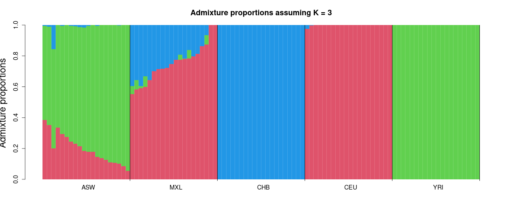
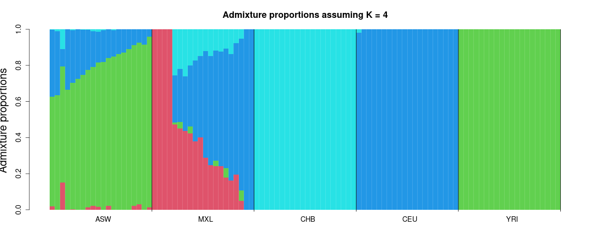
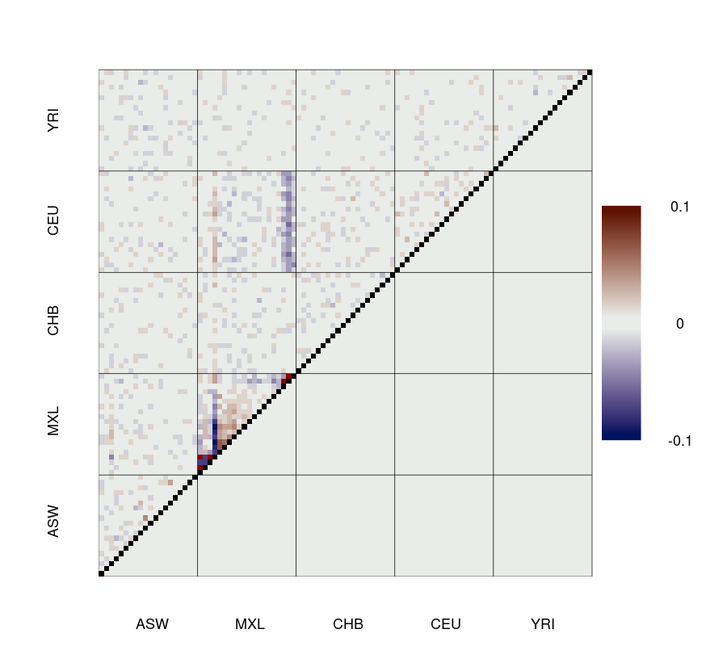
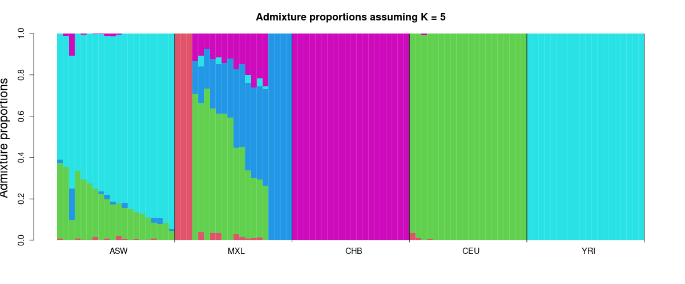

# NGSadmix Tutorial with admixer

[admixer](https://github.com/aalbrechtsen/admixer) is a new and faster implementation of the NGSadmix model. It reads the same Beagle genotype-likelihood files and estimates the same admixture proportions as the original `NGSadmix`. On the data below it was 11–23× faster (see [Comparison with the original NGSadmix](#comparison-with-the-original-ngsadmix)). It also computes the [evalAdmix](https://github.com/GenisGE/evalAdmix) correlation of residuals by default, so you can check how well the model fits.

## Install admixer

Prebuilt binary (Linux x86_64, no dependencies):

```bash
wget https://github.com/aalbrechtsen/admixer/raw/main/bin/admixer-linux-x86_64.tar.gz
tar xzf admixer-linux-x86_64.tar.gz
./admixer
```

Or build from source (needs a C++17 compiler with OpenMP, OpenBLAS and zlib):

```bash
git clone https://github.com/aalbrechtsen/admixer.git
cd admixer
make
```

Put `admixer` on your `PATH`, or replace `admixer` below with the full path to the binary. This tutorial used admixer 0.2.10.

## The data

100 individuals from five HapMap populations (20 each of ASW, CEU, CHB, MXL and YRI), with genotype likelihoods at 50,000 sites:

- `Demo/Data/Demo2input.gz`: Beagle genotype likelihoods
- `Demo/Data/Demo2pop.info`: the population of each individual, in the same order as the Beagle file

ASW (African Americans) and MXL (Mexicans in Los Angeles) are admixed populations. YRI, CEU and CHB represent African, European and East Asian ancestry.

Run all commands from the root of this repository, and write the results to `Demo/Results/Admixer`:

```bash
mkdir -p Demo/Results/Admixer
```

The command line is `admixer [options] input.beagle.gz K`. Run `admixer` without arguments for all options.

## One run

Start with three ancestral populations, K = 3:

```bash
admixer -j8 --seed=1 -o Demo/Results/Admixer/Demo2 Demo/Data/Demo2input.gz 3
```

<details>
<summary>Full screen output = log file <code>Demo2.3.log</code> (click to expand)</summary>

```text
admixer 0.2.10
Command: admixer -j8 --seed=1 -o Demo/Results/Admixer/Demo2 Demo/Data/Demo2input.gz 3
Input: genotype likelihoods (beagle) for 100 individuals at 50000 sites; 49475 sites after filtering (minMaf 0.05, minInd 0)
Missing GL entries (max - min GL < 0.05) left out: 163276 of 4947500 (3.30%)
Random seed: 1
Point estimation method: Block relaxation algorithm (Newton/QP steps with the exact curvature of the GL likelihood, BLAS kernels)
Convergence acceleration algorithm: QuasiNewton, 3 secant conditions, rejected extrapolations retried 2x with the step scaled by 0.5
Newton steps: register-blocked kernels for K = 3 instead of OpenBLAS (--smallk=0: OpenBLAS)
Point estimation will terminate when objective function delta < 0.0001
Size of GL data: 100x49475
Threads: 8
Initial loglikelihood: -6070739.751260
Starting main algorithm
1 (QN/Block)     Elapsed: 0.041    Loglikelihood: -4742882.640398    (delta): inf
2 (QN/Block)     Elapsed: 0.065    Loglikelihood: -4650049.531885    (delta): 92833.1
3 (QN/Block)     Elapsed: 0.091    Loglikelihood: -4592637.901497    (delta): 57411.6
4 (QN/Block)     Elapsed: 0.115    Loglikelihood: -4517821.018363    (delta): 74816.9
5 (QN/Block)     Elapsed: 0.138    Loglikelihood: -4346109.142707    (delta): 171712
6 (QN/Block)     Elapsed: 0.160    Loglikelihood: -4222570.451931    (delta): 123539
7 (QN/Block)     Elapsed: 0.182    Loglikelihood: -4155584.571287    (delta): 66985.9
8 (QN/Block)     Elapsed: 0.204    Loglikelihood: -4088441.538631    (delta): 67143
9 (QN/Block)     Elapsed: 0.226    Loglikelihood: -4029227.375545    (delta): 59214.2
10 (QN/Block)     Elapsed: 0.248    Loglikelihood: -3974427.396835    (delta): 54800
11 (QN/Block)     Elapsed: 0.269    Loglikelihood: -3917782.413215    (delta): 56645
12 (QN/Block)     Elapsed: 0.308    Loglikelihood: -3889451.429195    (delta): 28331
13 (QN/Block)     Elapsed: 0.329    Loglikelihood: -3876552.038020    (delta): 12899.4
14 (QN/Block)     Elapsed: 0.351    Loglikelihood: -3869959.405582    (delta): 6592.63
15 (QN/Block)     Elapsed: 0.372    Loglikelihood: -3867213.695576    (delta): 2745.71
16 (QN/Block)     Elapsed: 0.394    Loglikelihood: -3866412.355196    (delta): 801.34
17 (QN/Block)     Elapsed: 0.416    Loglikelihood: -3866161.899229    (delta): 250.456
18 (QN/Block)     Elapsed: 0.437    Loglikelihood: -3866100.595867    (delta): 61.3034
19 (QN/Block)     Elapsed: 0.459    Loglikelihood: -3866045.491658    (delta): 55.1042
20 (QN/Block)     Elapsed: 0.480    Loglikelihood: -3865992.246417    (delta): 53.2452
21 (QN/Block)     Elapsed: 0.502    Loglikelihood: -3865980.355681    (delta): 11.8907
22 (QN/Block)     Elapsed: 0.524    Loglikelihood: -3865972.292172    (delta): 8.06351
23 (QN/Block)     Elapsed: 0.561    Loglikelihood: -3865965.333598    (delta): 6.95857
24 (QN/Block)     Elapsed: 0.584    Loglikelihood: -3865964.401114    (delta): 0.932485
25 (QN/Block)     Elapsed: 0.611    Loglikelihood: -3865964.313718    (delta): 0.0873954
26 (QN/Block)     Elapsed: 0.638    Loglikelihood: -3865964.313416    (delta): 0.000302565
27 (QN/Block)     Elapsed: 0.660    Loglikelihood: -3865964.313411    (delta): 4.53088e-06
Quasi-Newton: 2 of 27 extrapolations rejected, 2 accepted after damping
Summary: 
Converged in 27 iterations (1.301 sec)
Loglikelihood: -3865964.313411
Loglikelihood over all GL entries, missing ones included (as NGSadmix): -3865964.313411
Optimality check (max projected gradient): P 1.02e-05, Q 6.74e-12
Writing output files.
evalAdmix correlation of residuals written to Demo/Results/Admixer/Demo2.3.corres.txt (0.18 sec)
Log written to Demo/Results/Admixer/Demo2.3.log
```

</details>

The run takes 1.5 seconds. Sites with minor allele frequency below 0.05 are removed (`--minMaf`, as in NGSadmix), which leaves 49,475 sites. The run ends at log-likelihood −3865964.31. The line `Loglikelihood over all GL entries, missing ones included (as NGSadmix)` can be compared directly with `best like=` in an NGSadmix log.

The output files:

| file | size | content |
|---|---|---|
| `Demo2.3.Q` | 2.7 kB | admixture proportions, 100 rows × 3 columns (as NGSadmix `.qopt`) |
| `Demo2.3.P.gz` | 0.5 MB | ancestral allele frequencies, 49,475 rows × 3 columns (as NGSadmix `.fopt.gz`) |
| `Demo2.3.corres.txt` | 94 kB | **evalAdmix correlation of residuals**, 100 × 100, `NA` on the diagonal |
| `Demo2.3.log` | 3 kB | the screen output |

admixer writes the evalAdmix correlations but does not plot them. Plot them, and the admixture proportions, in R with evalAdmix's `visFuns.R`:

```r
source("https://raw.githubusercontent.com/GenisGE/evalAdmix/master/visFuns.R")

pop <- read.table("Demo/Data/Demo2pop.info", as.is = TRUE)[, 1]
q <- read.table("Demo/Results/Admixer/Demo2.3.Q")
ord <- orderInds(pop = pop, q = q)

# admixture proportions
plotAdmix(q, pop = pop, ord = ord, cex.lab = 1.2, col = 2:10)

# evalAdmix correlation of residuals
r <- as.matrix(read.table("Demo/Results/Admixer/Demo2.3.corres.txt"))
plotCorRes(r, pop = pop, ord = ord, max_z = 0.1, title = "")
```

To write PNG files instead, wrap each plot in `png("file.png", width = 1200, height = 500)` … `dev.off()`. We used `width = 900, height = 800` for the correlation plot.



At K = 3, the three ancestries match YRI, CEU and CHB. ASW is a mix of African and European ancestry. MXL is a mix of European and East Asian ancestry.


In the evalAdmix plot, each square in the upper-left triangle is the correlation of the residuals of two individuals. The lower-right triangle shows the mean within and between populations. If the model fits, the correlations are close to 0.

The fit is wrong for MXL. MXL individuals have positive residual correlations with each other and negative correlations with CEU and CHB. Their "East Asian" ancestry is really Native American ancestry, which is not in the model at K = 3.

## Higher K, with several runs

Increase K. With more ancestral populations, a single run is more likely to end in a local optimum. `--conv 3` runs admixer with seeds 1, 2, 3, … (reading the data only once) until 3 runs agree with the best run. Two runs agree when the largest difference in any Q entry is below `--conv_thres` (default 0.01). admixer stops after at most `--max_runs` runs (default 10). This replaces `scripts/convergenceNGSadmix.sh` from [CONVERGENCE_TUTORIAL.md](CONVERGENCE_TUTORIAL.md).

```bash
admixer -j8 --seed=1 --conv 3 -o Demo/Results/Admixer/Demo2conv Demo/Data/Demo2input.gz 4
admixer -j8 --seed=1 --conv 3 -o Demo/Results/Admixer/Demo2conv Demo/Data/Demo2input.gz 5
```

The output files are those of the best run, plus `Demo2conv.K.conv`, which lists every run, best first.

`Demo2conv.4.conv`, 3.3 seconds in total:

```text
run	seed	loglik	loglik_diff	max_abs_dQ	mean_sum_abs_dQ	rmse_dQ	iterations	seconds	agrees
1	1	-3817737.880636	0.000000	0	0	0	29	0.79	1
2	2	-3817737.880643	-0.000007	2.23517e-05	3.99236e-06	6.34601e-06	29	0.82	1
3	3	-3817737.880651	-0.000015	1.67191e-05	3.10687e-06	4.82673e-06	28	0.80	1
```

`Demo2conv.5.conv`, 6.8 seconds in total:

```text
run	seed	loglik	loglik_diff	max_abs_dQ	mean_sum_abs_dQ	rmse_dQ	iterations	seconds	agrees
5	5	-3776213.664328	0.000000	0	0	0	34	1.07	1
3	3	-3776213.664328	-0.000000	2.50805e-06	3.26494e-07	5.24681e-07	34	1.13	1
2	2	-3776213.664334	-0.000006	1.67191e-05	3.63433e-06	5.37073e-06	36	1.29	1
1	1	-3776230.384927	-16.720599	0.339841	0.0155914	0.0439227	38	1.26	0
4	4	-3782023.429881	-5809.765552	1	0.238165	0.393226	33	1.06	0
```

At K = 4, the first three runs all reach the same solution. At K = 5, seeds 5, 3 and 2 agree. Seed 1 ends 16.7 log-likelihood units lower: one MXL individual is given mixed ancestry instead of the fifth ancestry alone. Seed 4 ends in a much worse local optimum. With a single run, seed 1 would have given a wrong answer.

Plot the results as above, replacing `Demo2.3` with `Demo2conv.4` or `Demo2conv.5`.





At K = 4, MXL has its own (Native American) ancestry, and most of the residual correlation between MXL and the other populations is gone. A few pairs of MXL individuals still have strong positive correlations.




At K = 5, the fifth ancestry is taken by a few MXL individuals, which suggests that they are related. The residual correlations between populations are close to 0. Some structure remains within MXL.

## Comparison with the original NGSadmix

We ran the Example 2 commands from [TUTORIAL.md](TUTORIAL.md) (NGSadmix, `-minMaf 0.05 -seed 4`, K = 3 and 4). We timed them against admixer runs with the same seed (`admixer --seed=4 Demo/Data/Demo2input.gz K`). Each program was run with 1 and with 8 threads (`-P` / `-j`), one run at a time, on an Intel Xeon Gold 6238 (2.1 GHz).

### Run time (wall clock, including reading the input)

| K | NGSadmix, 1 thread | admixer, 1 thread | speed-up | NGSadmix, 8 threads | admixer, 8 threads | speed-up |
|---|---|---|---|---|---|---|
| 3 | 69 s | 4.8 s | 15× | 17 s | 1.6 s | 11× |
| 4 | 129 s | 5.7 s | 23× | 32 s | 1.7 s | 19× |

admixer needs 29–30 iterations, while NGSadmix needs 225–343 EM iterations.

### Admixture proportions

We compared NGSadmix's Q with admixer's Q from this tutorial, after matching the ancestral populations of the two runs (the column order is arbitrary):

```r
cmpQ <- function(f1, f2) {
  a <- as.matrix(read.table(f1)); b <- as.matrix(read.table(f2)); K <- ncol(a)
  perms <- function(v) if (length(v) <= 1) list(v) else
    do.call(c, lapply(seq_along(v), function(i) lapply(perms(v[-i]), function(p) c(v[i], p))))
  min(sapply(perms(1:K), function(p) max(abs(a - b[, p]))))
}
cmpQ("Demo/Results/Demo2NGSadmixK3.qopt", "Demo/Results/Admixer/Demo2.3.Q")
cmpQ("Demo/Results/Demo2NGSadmixK4.qopt", "Demo/Results/Admixer/Demo2conv.4.Q")
```

| NGSadmix stopping rule | K | NGSadmix log-likelihood | admixer log-likelihood | max \|ΔQ\| |
|---|---|---|---|---|
| default | 3 | −3865964.42 | −3865964.31 | 0.0020 |
| default | 4 | −3817738.02 | −3817737.88 | 0.0010 |
| strict | 3 | −3865964.30 | −3865964.31 | 0.00006 |
| strict | 4 | −3817737.87 | −3817737.88 | 0.00003 |

The two programs reach the same admixture proportions. With its default stopping rule (`-tolLike50 0.1`), NGSadmix stops slightly before the optimum, so Q differs by up to 0.002. With a strict stopping rule (`-tol 1e-9 -tolLike50 1e-4 -maxiter 20000`, 650–950 iterations), NGSadmix's Q agrees with admixer's to within 0.0001.

Both programs can end in a local optimum, so always run several seeds: `--conv` in admixer, or [CONVERGENCE_TUTORIAL.md](CONVERGENCE_TUTORIAL.md) for NGSadmix.
