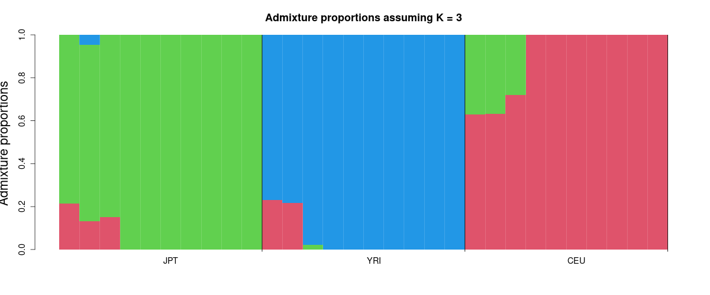
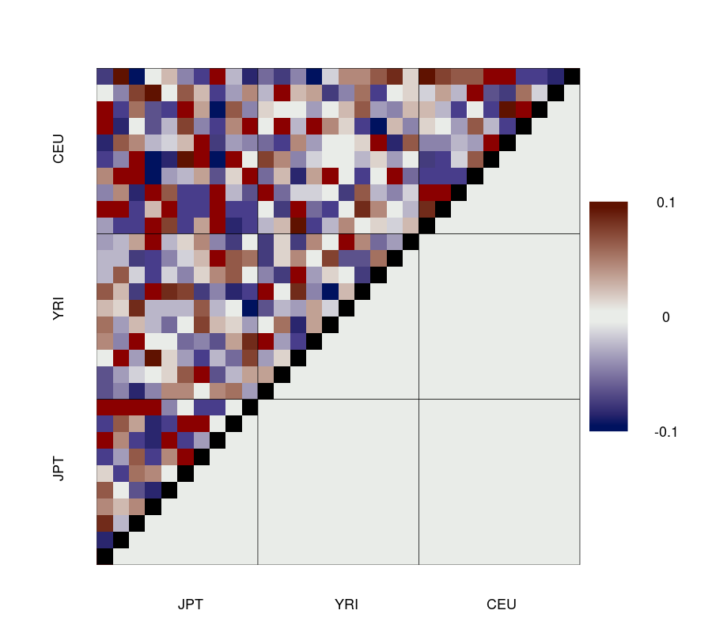
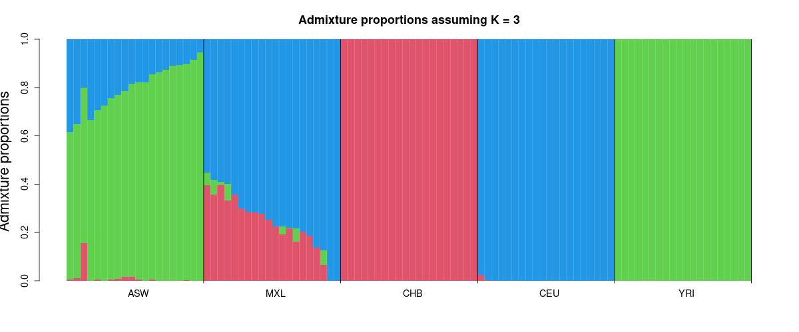
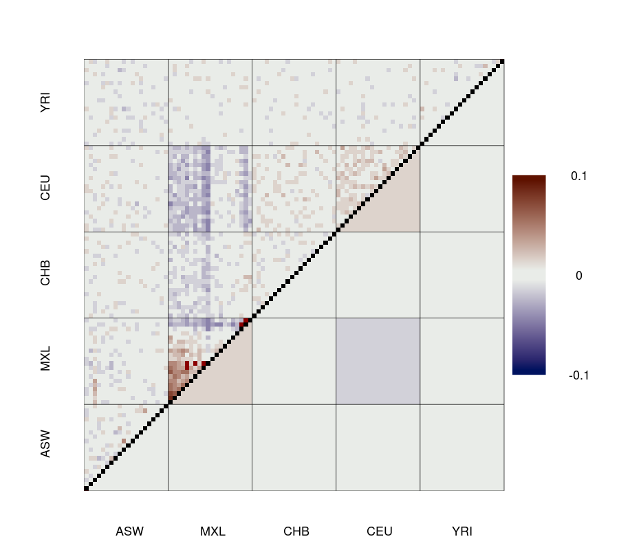
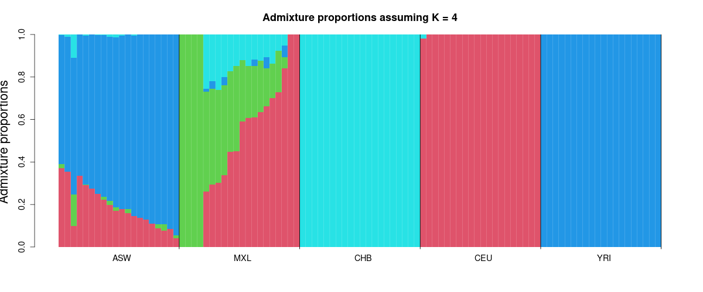
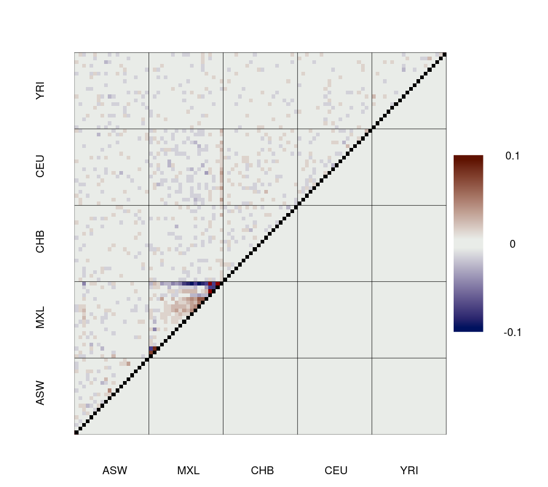

# NGSadmix Tutorial with admixer

[admixer](https://github.com/aalbrechtsen/admixer) is a new implementation of the NGSadmix model. It fits the same model to the same Beagle genotype-likelihood files, but it uses a faster optimisation algorithm (block relaxation with Newton steps and quasi-Newton acceleration). On the demo data in this repository it was 11–23× faster than the original `NGSadmix` and reaches the same admixture proportions. It also computes the [evalAdmix](https://github.com/GenisGE/evalAdmix) correlation of residuals by default.

This tutorial runs the same examples as [TUTORIAL.md](TUTORIAL.md), but with admixer. It ends with a comparison of the two programs (see [Comparison with the original NGSadmix](#comparison-with-the-original-ngsadmix)).

## Install admixer

Prebuilt binary (Linux x86_64, no dependencies):

```bash
wget https://github.com/aalbrechtsen/admixer/raw/main/bin/admixer-linux-x86_64.tar.gz
tar xzf admixer-linux-x86_64.tar.gz
./admixer
```

Or build from source (needs a C++17 compiler with OpenMP, OpenBLAS and zlib):

```bash
git clone https://github.com/aalbrechtsen/admixer.git
cd admixer
make
```

Put `admixer` on your `PATH`, or replace `admixer` below with the full path to the binary. This tutorial used admixer 0.2.10.

## Setup

Run all commands from the root of this repository:

```bash
mkdir -p Demo/Results/Admixer
```

The input files are the same as in [TUTORIAL.md](TUTORIAL.md): `Demo/Data/Demo1input.gz`, `Demo/Data/Demo1pop.info`, `Demo/Data/Demo2input.gz` and `Demo/Data/Demo2pop.info`.

## Command Line

```bash
admixer [options] input.beagle.gz K
```

The number of ancestral populations `K` comes after the input file. The main options, with the matching `NGSadmix` option:

| admixer | NGSadmix | meaning |
|---|---|---|
| `-jX` | `-P X` | number of threads (admixer default 8) |
| `--seed=X` | `-seed X` | random seed (admixer default 43) |
| `-o NAME` | `-o NAME` | output prefix |
| `--minMaf=X` | `-minMaf X` | minimum minor allele frequency (default 0.05 in both) |
| `--misTol=X` | `-misTol X` | GLs with max − min < X count as missing (default 0.05 in both) |
| `--minInd=X` | `-minInd X` | minimum number of individuals with data at a site |
| `--conv X` | (see [CONVERGENCE_TUTORIAL.md](CONVERGENCE_TUTORIAL.md)) | repeat with new seeds until X runs agree |

Run `admixer` without arguments for the full list.

## Output Files

admixer writes its output in ADMIXTURE's format, with `K` in the file name:

- `NAME.K.Q`: admixture proportions, one row per individual (same as NGSadmix `.qopt`)
- `NAME.K.P.gz`: ancestral allele frequencies, one row per site that passes the filters (same as NGSadmix `.fopt.gz`)
- `NAME.K.corres.txt`: evalAdmix correlation of residuals between individuals
- `NAME.K.log`: the screen output

admixer writes the evalAdmix correlations but does not plot them. The R code below shows how to make the plot.

## Example 1: Small Three-Population Dataset

30 individuals (10 CEU, 10 JPT, 10 YRI), 5,616 sites.

```bash
admixer -j8 --seed=1 -o Demo/Results/Admixer/Demo1admixer Demo/Data/Demo1input.gz 3
```

<details>
<summary>Example output</summary>

```text
admixer 0.2.10
Command: admixer -j8 --seed=1 -o Demo/Results/Admixer/Demo1admixer Demo/Data/Demo1input.gz 3
Input: genotype likelihoods (beagle) for 30 individuals at 5616 sites; 5616 sites after filtering (minMaf 0.05, minInd 0)
Missing GL entries (max - min GL < 0.05) left out: 4363 of 168480 (2.59%)
Random seed: 1
...
Converged in 22 iterations (0.096 sec)
Loglikelihood: -113205.784530
Loglikelihood over all GL entries, missing ones included (as NGSadmix): -113205.784530
Optimality check (max projected gradient): P 2.93e-05, Q 3.62e-08
Writing output files.
evalAdmix correlation of residuals written to Demo/Results/Admixer/Demo1admixer.3.corres.txt (0.01 sec)
Log written to Demo/Results/Admixer/Demo1admixer.3.log
```

</details>

The line `Loglikelihood over all GL entries, missing ones included (as NGSadmix)` can be compared directly with the `best like=` value in an NGSadmix log.

### Plot the admixture proportions and the evalAdmix residuals

The plotting functions come from evalAdmix's `visFuns.R`:

```r
source("https://raw.githubusercontent.com/GenisGE/evalAdmix/master/visFuns.R")

pop <- read.table("Demo/Data/Demo1pop.info", as.is = TRUE)[, 1]
q <- read.table("Demo/Results/Admixer/Demo1admixer.3.Q")
ord <- orderInds(pop = pop, q = q)

# admixture proportions
plotAdmix(q, pop = pop, ord = ord, cex.lab = 1.2, col = 2:10)

# evalAdmix correlation of residuals
r <- as.matrix(read.table("Demo/Results/Admixer/Demo1admixer.3.corres.txt"))
plotCorRes(r, pop = pop, ord = ord, max_z = 0.1, title = "")
```

To write PNG files instead, wrap each plot in `png("file.png", width = 1200, height = 500)` … `dev.off()` (we used `width = 900, height = 800` for the correlation plot).





In the evalAdmix plot, each square is the correlation of the residuals of two individuals. The upper-left triangle shows pairs of individuals, and the lower-right triangle shows the mean within and between populations. Values near 0 mean the model fits. Positive correlations within a population mean that the model does not capture all of its structure. With only 5,616 sites, the per-pair correlations in Demo1 are noisy.

## Example 2: Larger Dataset

100 individuals (20 each of ASW, CEU, CHB, MXL, YRI), 50,000 sites.

```bash
admixer -j8 --seed=4 -o Demo/Results/Admixer/Demo2admixer Demo/Data/Demo2input.gz 3
admixer -j8 --seed=4 -o Demo/Results/Admixer/Demo2admixer Demo/Data/Demo2input.gz 4
```

Both runs use the same prefix. The output files differ because `K` is part of the file name (`Demo2admixer.3.Q`, `Demo2admixer.4.Q`).

<details>
<summary>Example output (end of each log)</summary>

```text
Input: genotype likelihoods (beagle) for 100 individuals at 50000 sites; 49475 sites after filtering (minMaf 0.05, minInd 0)
Missing GL entries (max - min GL < 0.05) left out: 163276 of 4947500 (3.30%)
...
Converged in 29 iterations (1.403 sec)
Loglikelihood: -3865964.313412
Loglikelihood over all GL entries, missing ones included (as NGSadmix): -3865964.313412

Input: genotype likelihoods (beagle) for 100 individuals at 50000 sites; 49475 sites after filtering (minMaf 0.05, minInd 0)
Missing GL entries (max - min GL < 0.05) left out: 163276 of 4947500 (3.30%)
...
Converged in 30 iterations (1.477 sec)
Loglikelihood: -3817737.880636
Loglikelihood over all GL entries, missing ones included (as NGSadmix): -3817737.880636
```

</details>

Plot as in Example 1, with `Demo/Data/Demo2pop.info` and `Demo/Results/Admixer/Demo2admixer.3.Q` / `.3.corres.txt` (and `.4.` for K=4).





At K=3, evalAdmix shows that the model does not fit well. MXL individuals have positive residual correlations with each other and negative ones with CEU and CHB. A single European and a single East Asian ancestry do not describe MXL well, because MXL has Native American ancestry.




## Example 3: Several Seeds with a Convergence Test

With larger `K`, a single run can end in a local optimum. `--conv X` runs admixer with consecutive seeds, reading the data only once, until `X` runs agree with the best run. Two runs agree when the largest difference in any Q entry is below `--conv_thres` (default 0.01). It stops after at most `--max_runs` runs (default 10). This replaces `scripts/convergenceNGSadmix.sh` from [CONVERGENCE_TUTORIAL.md](CONVERGENCE_TUTORIAL.md).

```bash
admixer -j8 --seed=1 --conv 3 -o Demo/Results/Admixer/Demo2admixerConv Demo/Data/Demo2input.gz 5
cat Demo/Results/Admixer/Demo2admixerConv.5.conv
```

<details>
<summary>Example output</summary>

```text
run	seed	loglik	loglik_diff	max_abs_dQ	mean_sum_abs_dQ	rmse_dQ	iterations	seconds	agrees
5	5	-3776213.664328	0.000000	0	0	0	34	1.07	1
3	3	-3776213.664328	-0.000000	2.50805e-06	3.26494e-07	5.24681e-07	34	1.16	1
2	2	-3776213.664334	-0.000006	1.67191e-05	3.63433e-06	5.37073e-06	36	1.29	1
1	1	-3776230.384927	-16.720599	0.339841	0.0155914	0.0439227	38	1.28	0
4	4	-3782023.429881	-5809.765552	1	0.238165	0.393226	33	1.07	0
```

</details>

Five runs took 6.5 seconds in total. Seeds 2, 3 and 5 reach the same solution. Seeds 1 and 4 end in local optima, so a single run with seed 1 would have given a wrong answer. The output files (`.5.Q`, `.5.P.gz`, `.5.corres.txt`) are from the best run.




At K=5 the residual correlations between populations are close to 0. Some structure remains within MXL.

## Comparison with the original NGSadmix

We ran the commands from [TUTORIAL.md](TUTORIAL.md) (NGSadmix, `-minMaf 0.05`, seed 1 for Demo1 and seed 4 for Demo2) and the admixer commands above with the same seeds. Each program was run with 1 and with 8 threads (`-P` / `-j`), one run at a time, on an Intel Xeon Gold 6238 (2.1 GHz).

### Run time (wall clock, including reading the input)

| data | K | NGSadmix, 1 thread | admixer, 1 thread | speed-up | NGSadmix, 8 threads | admixer, 8 threads | speed-up |
|---|---|---|---|---|---|---|---|
| Demo1 | 3 | 3.5 s | 0.25 s | 14× | 2.3 s | 0.10 s | 23× |
| Demo2 | 3 | 69 s | 4.8 s | 15× | 17 s | 1.6 s | 11× |
| Demo2 | 4 | 129 s | 5.7 s | 23× | 32 s | 1.7 s | 19× |

admixer needs 22–30 iterations, while NGSadmix needs 200–350 EM iterations.

### Admixture proportions

We compared the Q matrices with the R code below, after matching the ancestral populations of the two runs (the column order is arbitrary):

```r
cmpQ <- function(f1, f2) {
  a <- as.matrix(read.table(f1)); b <- as.matrix(read.table(f2)); K <- ncol(a)
  perms <- function(v) if (length(v) <= 1) list(v) else
    do.call(c, lapply(seq_along(v), function(i) lapply(perms(v[-i]), function(p) c(v[i], p))))
  min(sapply(perms(1:K), function(p) max(abs(a - b[, p]))))
}
cmpQ("Demo/Results/Demo2NGSadmixK3.qopt", "Demo/Results/Admixer/Demo2admixer.3.Q")
```

| data | K | NGSadmix log-likelihood | admixer log-likelihood | max \|ΔQ\| |
|---|---|---|---|---|
| Demo1, NGSadmix seed 1 | 3 | −113212.72 | −113205.78 | 0.215 |
| Demo1, NGSadmix seed 2 | 3 | −113205.78 | −113205.78 | 0.0002 |
| Demo2 | 3 | −3865964.42 | −3865964.31 | 0.0020 |
| Demo2 | 4 | −3817738.02 | −3817737.88 | 0.0010 |
| Demo2, NGSadmix with strict stopping rule | 3 | −3865964.30 | −3865964.31 | 0.00006 |
| Demo2, NGSadmix with strict stopping rule | 4 | −3817737.87 | −3817737.88 | 0.00003 |

The two programs reach the same admixture proportions:

- **Demo1:** NGSadmix with seed 1 (the seed used in [TUTORIAL.md](TUTORIAL.md)) ends in a local optimum, 7 log-likelihood units below the best solution. NGSadmix seeds 2, 3, 7 and 8 reach the solution that admixer finds with seed 1, and their Q differs from admixer's by 0.0002 to 0.0014. Always run several seeds.
- **Demo2:** with its default stopping rule (`-tolLike50 0.1`), NGSadmix stops slightly before the optimum, so Q differs by up to 0.002. With a strict stopping rule (`-tol 1e-9 -tolLike50 1e-4 -maxiter 20000`, 650–950 iterations), NGSadmix's Q agrees with admixer's to within 0.0001.
