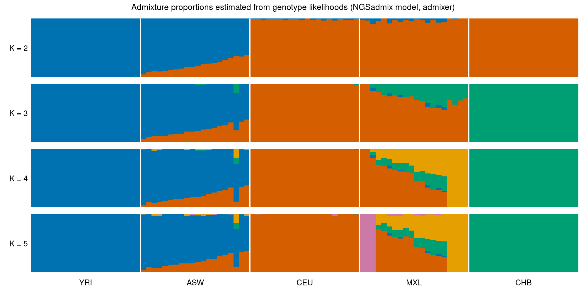
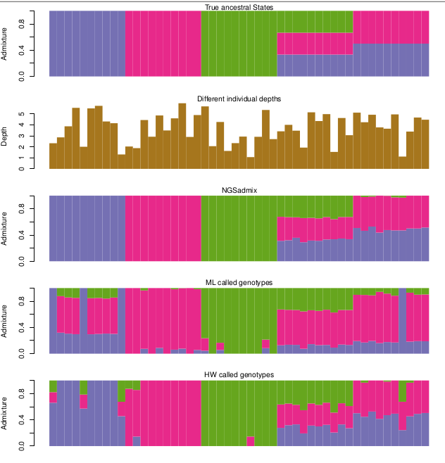

# NGSadmix

**Admixture proportions from low-depth sequencing data, using genotype likelihoods.**



<sub>The demo data in this repository: 100 individuals from five HapMap populations, 49,475 sites. Every K was run with admixer `--conv 3` and takes about 1 second. Made with [docs/images/readme_figure.R](docs/images/readme_figure.R).</sub>

NGSadmix estimates individual admixture proportions and ancestral allele frequencies from next-generation sequencing data. It works directly on genotype likelihoods rather than on called genotypes, so it accounts for genotype uncertainty. This makes it suited to low- and medium-depth data, where called genotypes give biased estimates.

The model is the same as in ADMIXTURE and STRUCTURE, which describe population structure and recent admixture through differences in allele frequencies between ancestral populations.

## Install NGSadmix's new faster version: admixer

[admixer](https://github.com/aalbrechtsen/admixer) is a new implementation of the NGSadmix model and the recommended way to run NGSadmix. It reads the same Beagle files, applies the same filters, and estimates the same admixture proportions, but:

- it is **11–23× faster** on the demo data (Newton steps with quasi-Newton acceleration instead of accelerated EM);
- `--conv` runs several seeds and checks that they converge to the same solution, in one command;
- it writes the [evalAdmix](https://github.com/GenisGE/evalAdmix) correlation of residuals by default, so you can check how well the model fits.

Prebuilt binary (Linux x86_64, no dependencies):

```bash
wget https://github.com/aalbrechtsen/admixer/raw/main/bin/admixer-linux-x86_64.tar.gz
tar xzf admixer-linux-x86_64.tar.gz
./admixer
```

To build from source, see the [admixer README](https://github.com/aalbrechtsen/admixer#from-source).

### Quick start

```bash
# one run, K = 3, 8 threads
admixer -j8 --seed=1 -o myresults input.beagle.gz 3

# several seeds until 3 runs agree (recommended)
admixer -j8 --seed=1 --conv 3 -o myresults input.beagle.gz 3
```

Output:

| file | content |
|---|---|
| `myresults.3.Q` | admixture proportions, one row per individual |
| `myresults.3.P.gz` | ancestral allele frequencies, one row per site |
| `myresults.3.corres.txt` | evalAdmix correlation of residuals between individuals |
| `myresults.3.log` | run log, including the log-likelihood |
| `myresults.3.conv` | with `--conv`: one line per run |

| admixer option | NGSadmix option | meaning |
|---|---|---|
| `-jX` | `-P X` | number of threads |
| `--seed=X` | `-seed X` | random seed |
| `-o NAME` | `-o NAME` | output prefix |
| `--minMaf=X` | `-minMaf X` | minimum minor allele frequency (default 0.05) |
| `--misTol=X` | `-misTol X` | genotype likelihoods with max − min < X count as missing (default 0.05) |
| `--minInd=X` | `-minInd X` | minimum number of individuals with data at a site |

## Tutorials

| tutorial | content |
|---|---|
| [ADMIXER_TUTORIAL.md](ADMIXER_TUTORIAL.md) | **Start here.** The demo data with admixer: runs, admixture and evalAdmix plots, convergence over seeds, and a comparison with the original NGSadmix (run time and admixture proportions). |
| [TUTORIAL.md](TUTORIAL.md) | The demo data with the original NGSadmix program. |
| [CONVERGENCE_TUTORIAL.md](CONVERGENCE_TUTORIAL.md) | Checking convergence across seeds with the original NGSadmix program. |

## The original NGSadmix program

The original program (`NGSadmix.cpp` in this repository) is still available. Installation, usage, output files and options are on a separate page: **[ORIGINAL_NGSADMIX.md](ORIGINAL_NGSADMIX.md)**.

## Input: Beagle genotype-likelihood files

Both admixer and NGSadmix read genotype likelihoods in Beagle format, optionally gzip-compressed:

- column 1: marker name
- column 2: allele 1
- column 3: allele 2
- then 3 columns per individual: the likelihoods of the genotypes 11, 12 and 22

The likelihoods are usually normalised to sum to 1 for each individual at a site. They are still likelihoods, not posterior genotype probabilities.

### From BAM files with ANGSD

```bash
angsd -GL 1 -out genolike -nThreads 10 -doGlf 2 -doMajorMinor 1 -SNP_pval 1e-6 -doMaf 1 -bam bam.filelist
```

This writes `genolike.beagle.gz`. See the [ANGSD documentation](https://www.popgen.dk/angsd/index.php/Beagle_input).

### From VCF files

A VCF file with genotype likelihoods can be converted with `vcftools` (chromosomes must be given):

```bash
vcftools --vcf input.vcf --out test --BEAGLE-GL --chr 1,2
```

or written with `bcftools query`.

## Why genotype likelihoods?

In the simulation below, individuals have different sequencing depths (second panel). NGSadmix recovers the true admixture proportions. Called genotypes give admixture proportions that depend on depth, so they create structure that does not exist.

<a href="docs/images/NgsAdmix.png">
  
</a>

## Citation

If you use NGSadmix or admixer for genotype likelihoods, cite:

> Skotte, L., Korneliussen, T. S., and Albrechtsen, A. (2013). Estimating individual admixture proportions from next generation sequencing data. *Genetics* 195(3): 693–702.

If you use the evalAdmix output, also cite:

> Garcia-Erill, G., and Albrechtsen, A. (2020). Evaluation of model fit of inferred admixture proportions. *Molecular Ecology Resources* 20(4): 936–949.
